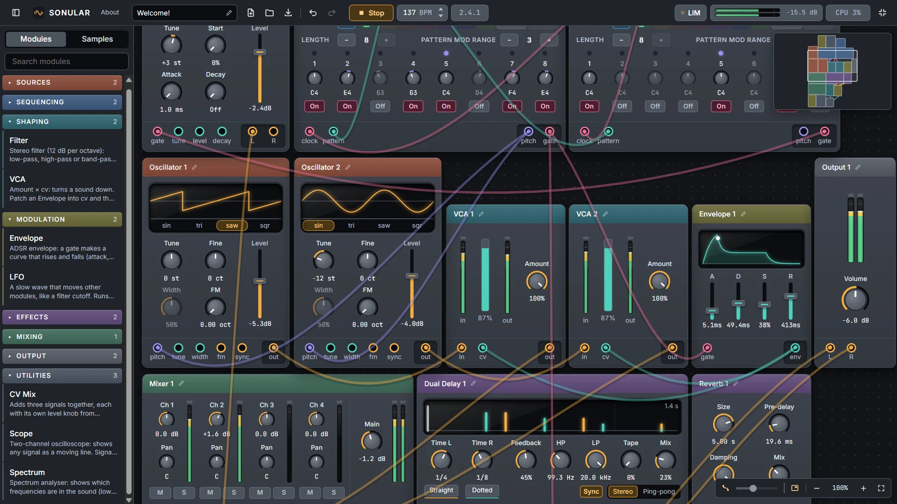

# Sonular

A modular online and offline music/noise making environment. A hobby project, made with love. I don't write the code myself: it is built together with an AI coding assistant (Claude), while I decide what the app does, how it looks and sounds, and test it.

Faust-powered DSP, Svelte UI, installable PWA.
https://sonular.app/

Patch modules together with cables, shape sound, save/load patches, record output.
Sonular is free and open source, and aims for sound quality that holds up in real music production.

> **Status:** early development... more to come.



## Principles

- **Sounds good.** Band-limited oscillators, click-free parameter changes, well-behaved filters.
- **Lean on CPU.** Modules that aren't heard aren't computed; idle modules sleep.
- **Works offline.** Installable as a Progressive Web App (PWA).
- **Grows over time.** Many modules — including niche ones — each a self-contained unit.

## Tech

- [Svelte](https://svelte.dev) + [TypeScript](https://www.typescriptlang.org) for the interface
- [Vite](https://vite.dev) for development and builds
- [Faust](https://faust.grame.fr) for DSP, compiled to WebAssembly at build time — see [docs/faust-notes.md](docs/faust-notes.md)
- Web Audio `AudioWorklet` hosting a single custom engine

How it fits together, its limits and what's planned: [docs/architecture.md](docs/architecture.md).

## Development

Requires [Node.js](https://nodejs.org) 22 or newer.

```bash
npm install
npm run dev      # start the dev server at http://localhost:5173
npm run build    # production build in dist/ (includes the offline service worker)
npm run preview  # serve the production build at http://localhost:4173 (install/offline testing)
npm run check    # type-check
npm test         # run the automated tests
npm run icons    # regenerate app icons from public/app-icon.svg
```

The service worker is only active in production builds (`npm run preview`), not in `npm run dev`.

## License

[GPL-3.0-or-later](LICENSE)
